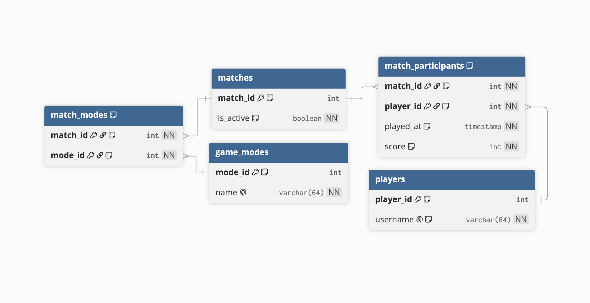

# ex603-game-telemetry-database

by Nikki Phach

This project models a relational database for **game telemetry**. I chose this topic because my engineering background centers around gaming, and I think I could utilize this model for current/future projects.

### The Domain

This application records information from an online game. In the game, the player can choose their player identity/ username. Matches are what is being supplied to the player. When a player begins a match, it is written to the database. When the match is completed, the application records an event and updates its status, along with timestamp and player's score. Game mode identifies that kind of game played (time-based, sudden death, etc).

### Schema

| table                | role     | purpose                             |
| -------------------- | -------- | ----------------------------------- |
| `players`            | actor    | registered identities for users     |
| `matches`            | producer | a game session, supplied to players |
| `match_participants` | event    | links players to matches            |
| `game_modes`         | catalog  | named modes for analytics           |
| `match_modes`        | junction | links matches to game modes         |

- `player_id`, `match_id`, and `mode_id` are identity integers. Usernames and mode names are unique but are not primary keys, so that they can be modfied without rewriting foreign keys in other tables.
- `match_participants` is keyed by `(match_id, player_id)` and `match_modes` by `(match_id, mode_id)`. This ensures that there is at most one participation row per player per match and one row per mode tag per match.
- Modes are attached through `match_modes` instead of a single `mode_id` on `matches`. This is because a match may be attributed with multiple game modes (multiplayer, difficulty, etc).
- `players` and `game_modes` use **RESTRICT** so participation and mode tags are not removed when one of these rows are deleted. They are saved for analytic history. `match_participants` and `match_modes` to `matches` use **CASCADE** so that deleting a match removes the corresponding child rows, because they have no meaning without the match.
- Most columns are `NOT NULL` because they are important to the analytics this system tracks. Incomplete events cannot be stored, and every recorded play we track must include who, which match, when, and score.
- `players`, `matches`, and `game_modes` are created first because they contain no foreign keys, then `match_participants` and `match_modes` because they reference these tables.

### Query Catalogue

### Technical Highlights

### What I Would Do Differently

### Video Presentation

### How To Run
